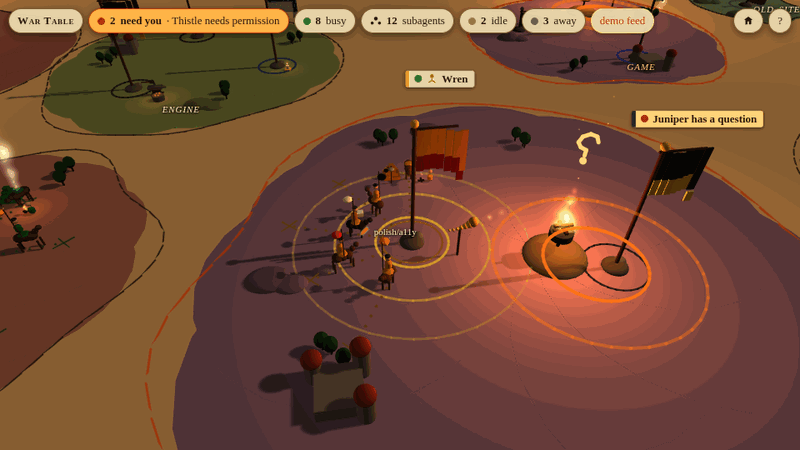
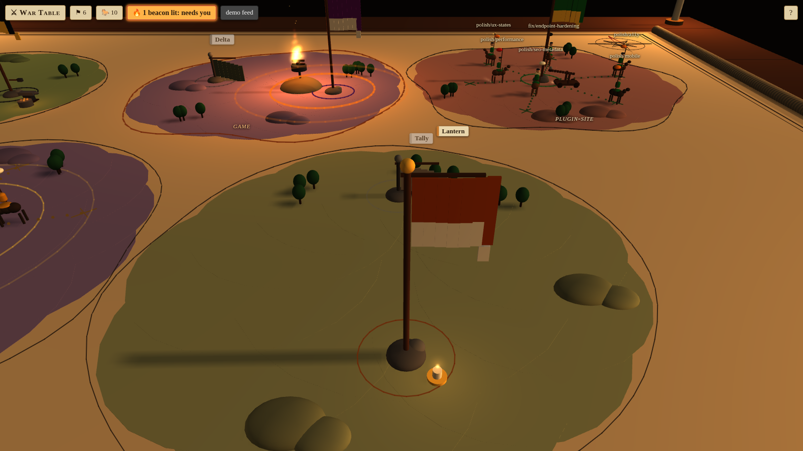
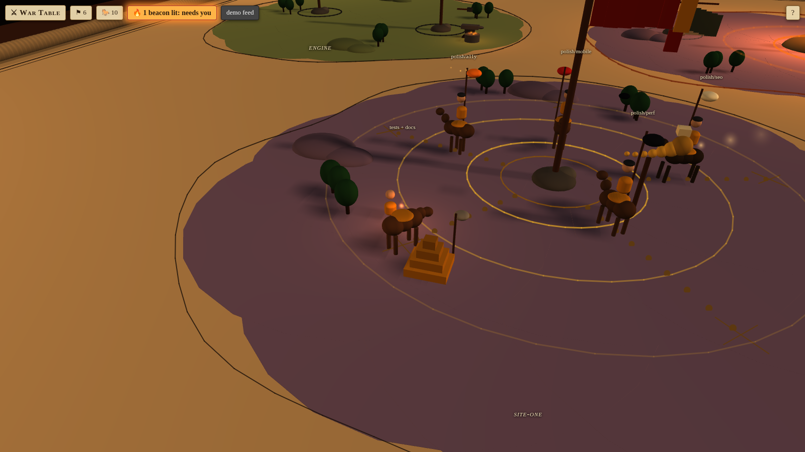
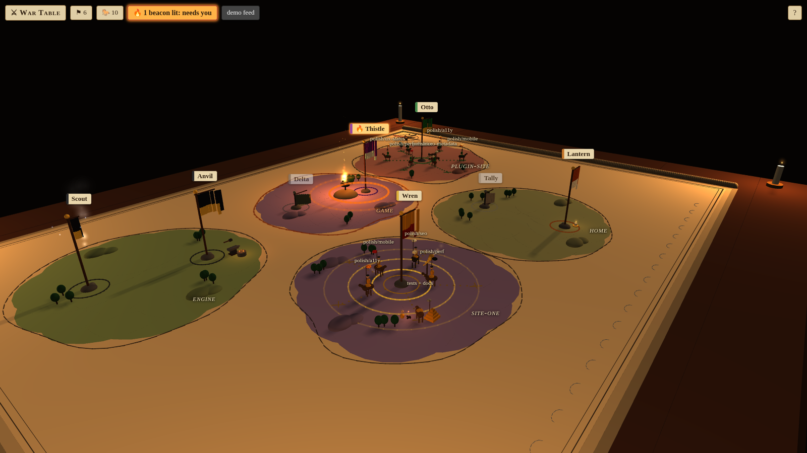
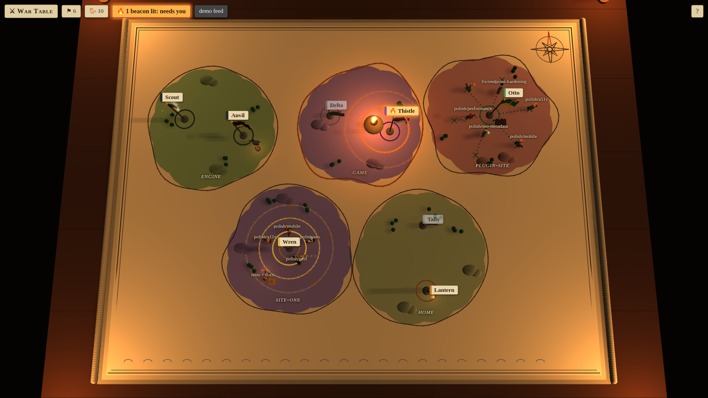
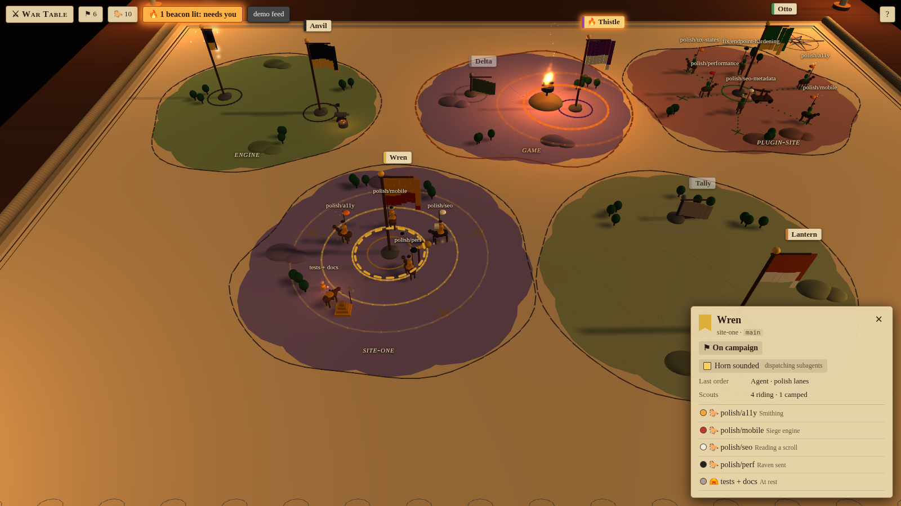
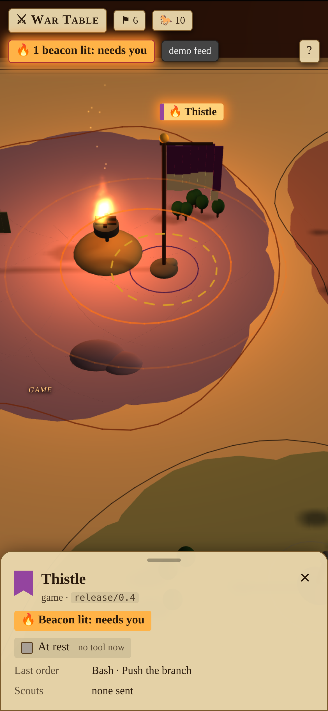

# agentviz-wartable

Claude Code sessions and their subagents drawn as a candle-lit medieval
campaign war table, rendered with
[Strata](https://github.com/Preponderous-Software/strata). Each repo is a
region on a parchment map. Each session is a banner planted in its region,
and its subagents are mounted scouts riding out from it. When a session needs
you, a beacon fire is lit on a hill beside its banner.

Part of the [agentviz](https://github.com/dmccoystephenson/agentviz) family
(#10, port 8850). Every image below comes from the bundled demo feed
(`--fixture`), never from live sessions.


*The whole table from the demo feed. Six regions (repos) hold eight banners
(sessions). Wren and Otto have sent out scouts (subagents). Thistle's beacon
is lit because it is waiting on you, and Delta and Tally have lowered their
banners (offline).*



*Five seconds of motion: Wren's scouts ride their dotted paths while gold
ripples spread from the war horn (delegating). Otto's catapult winds and
throws, Anvil's hammer falls on the anvil, and Thistle's beacon burns.*

## Close-ups


*Otto, a lead with six scouts. Each rider wears Otto's banner colours (cloak
and saddle cloth), so you can tell whose scout it is. Each scout's pennant
is coloured by what that subagent is doing, and it rides a dotted ink path
to a cross on the map. Otto is running commands, so a catapult rolls and
throws beside his banner.*


*Thistle is waiting on you: a beacon fire burns on a hill beside the banner.
It is drawn on top of everything, a ring pulses out across the map, the
region's border glows, and the HUD shows "beacon lit: needs you". Tap the
HUD chip to jump to it.*



*In the home region, Lantern is idle: the banner hangs still and a low
candle stub burns beside it. Tally is offline, so the banner is lowered to
a stump and greyed.*



*A resting scout (no tool call for two minutes). It has made camp at the end
of its path: a tent in its lead's colours, a small campfire, the rider
sitting by it, and its pennant planted in the ground.*


*In the engine region, Anvil is editing (an anvil throwing sparks as the
hammer falls) and Scout is thinking (the banner is furled, with pale motes
drifting around it). Scout has also gone quiet for over five minutes, so it
counts as stalled and grey smoke rises from its banner.*

## Two more angles



*Low and from the side, the way you would see it standing at the table.*



*From directly above, the table reads as a map: regions, banners, paths and
crosses.*

## Selecting



*Click a banner or scout to select it. The panel shows the session's name,
place and branch, its state and action, its last order, and its scouts. Tap a
scout in the list to jump to it.*



*On a phone (390 x 844 at DPR 3) you orbit with one finger and pinch to zoom.
Tapping a banner opens a bottom sheet, shown here on Thistle, the session
waiting on you.*

## Legend

| What you see | Meaning | Shown in |
|---|---|---|
| Region on the map (tint and outline from its seed) | a place (repo / working-directory basename) | hero |
| Banner (field colour + metal band from the session seed) | a session | hero |
| Banner waving | `busy` | hero |
| Beacon fire on a hill, pulsing ring, glowing border, HUD chip | `waiting`: **needs you** | closeup-waiting |
| Banner still, low candle stub | `idle` (and `dim`, greyer) | closeup-idle-offline |
| Banner lowered to a stump, greyed | `offline` | closeup-idle-offline |
| Grey smoke rising from the banner | `stalled` (busy, nothing written for 5 min) | closeup-actions (Scout) |
| Smith's anvil, falling hammer, sparks | action `edit` | closeup-actions |
| Catapult rolling, winding and throwing a stone | action `run` | closeup-lead |
| Scroll unrolling on a lectern | action `read` | (scouts in the GIF) |
| Raven flying from the banner to the map edge and back, dotted flight line | action `web` | (none in the demo feed for a lead) |
| War horn on a stand, gold ripples spreading over the map | action `delegate` | motion.gif |
| Banner furled tight, pale motes | action `think` | closeup-actions |
| War drum being beaten | action `other` | (none in the demo feed) |
| Mounted scout in the lead's colours, on a dotted path to an ink cross | a subagent (follower) of that lead | closeup-lead |
| Scout riding out and back | follower `active` | motion.gif |
| Tent, campfire, rider seated, pennant planted | follower `resting` | closeup-resting |
| Scout pennant colour | follower action: orange edit, crimson run, cream read, black web, gold delegate, blue think, violet other | closeup-lead |
| Gold dashed ring | the selected banner or scout | panel-desktop |

Four candles at the table's corners are the room's light, and the beacon
fires take light priority over them, so they stay bright on weak devices.

## Run

```bash
python3 -m vendor.agentfeed serve --web web --port 8850             # live sessions on this machine
python3 -m vendor.agentfeed serve --web web --port 8850 --fixture   # the demo feed
```

Then open http://127.0.0.1:8850/ (it binds to 127.0.0.1 only). `?fixture=1`
shows the demo feed from a live server, `?fps=1` shows frame stats, and
`?drive=1` hands scene time to tools.

## Build

The built engine (`web/wartable-engine.js` + `.wasm`) and the kit scripts are
committed, so serving needs only Python. To rebuild after changing
`scene/main.cpp` (emsdk 6.0.11; Strata 0.10.0 is downloaded into `.strata/`):

```bash
scene/build.sh
```

## Test

```bash
python3 -m unittest discover -s tests                                # serves the fixture: page, assets, feed
NODE_PATH=/root/arcade-watch/node_modules node tests/smoke.cjs       # headless Chromium: draws, taps, no console errors
python3 -m vendor.agentfeed serve --web web --port 8950 --fixture &
NODE_PATH=/root/arcade-watch/node_modules node tests/screenshots.cjs http://127.0.0.1:8950/   # every image in docs/media/
```

## How it fits together

- `vendor/agentfeed/`: the shared feed, vendored from agentviz (do not edit here).
- `scene/main.cpp`: the Strata web-kit scene. It draws regions, banners,
  props and scouts from rows the page writes each frame.
- `web/wartable.js`: polls `/api/agents` every 2 s, lays out the map (regions
  in a grid, banners round each region's centre, scout points fanned out from
  each banner), eases between snapshots by id, and handles picking, labels and
  the panel.
