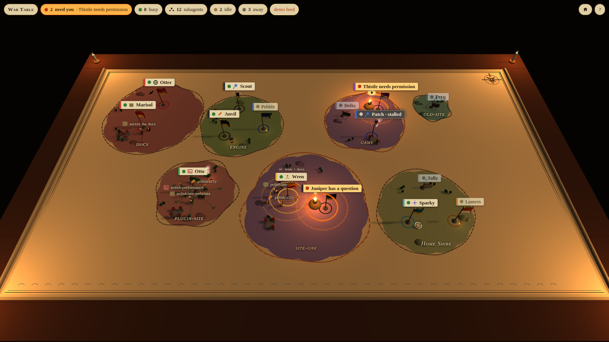
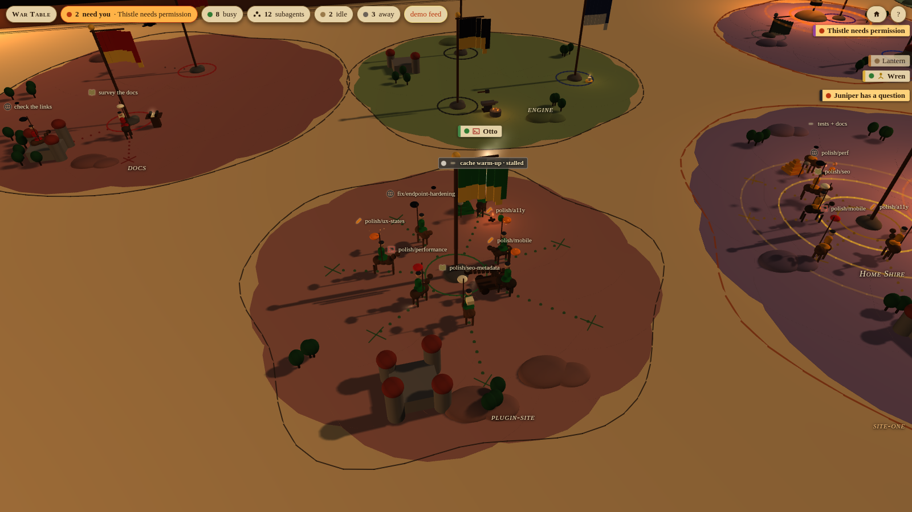
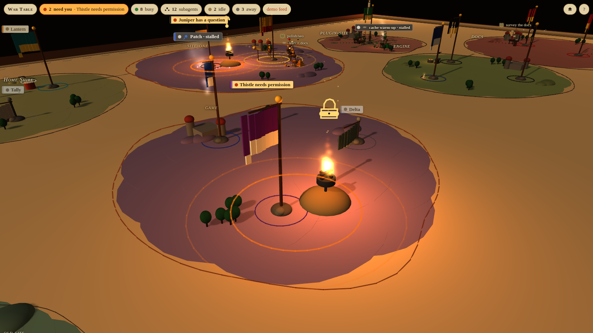
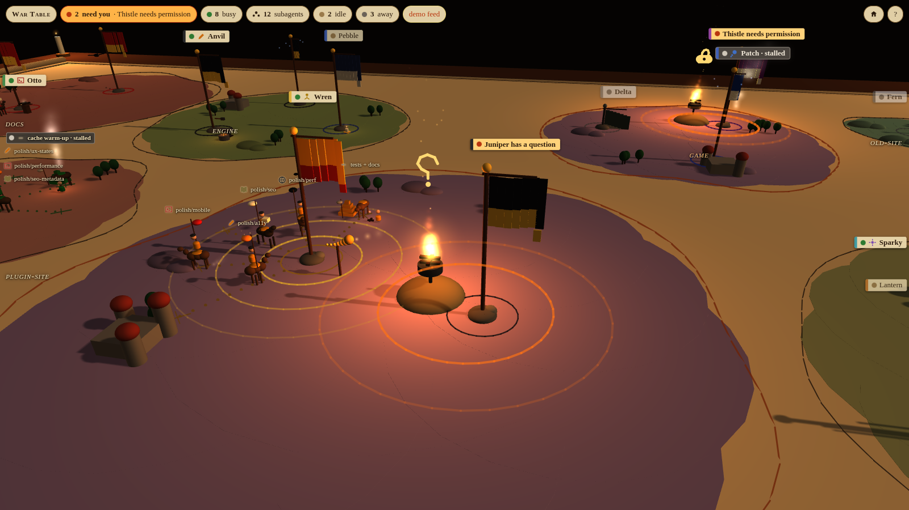
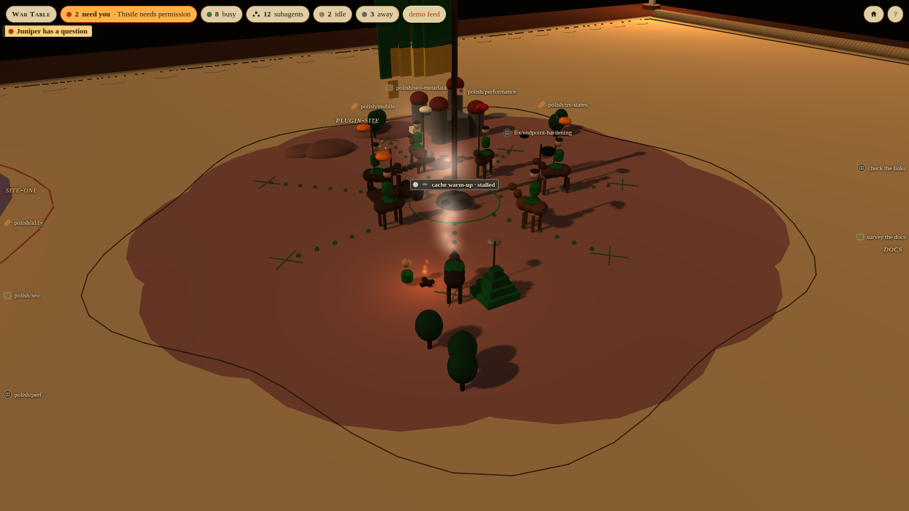
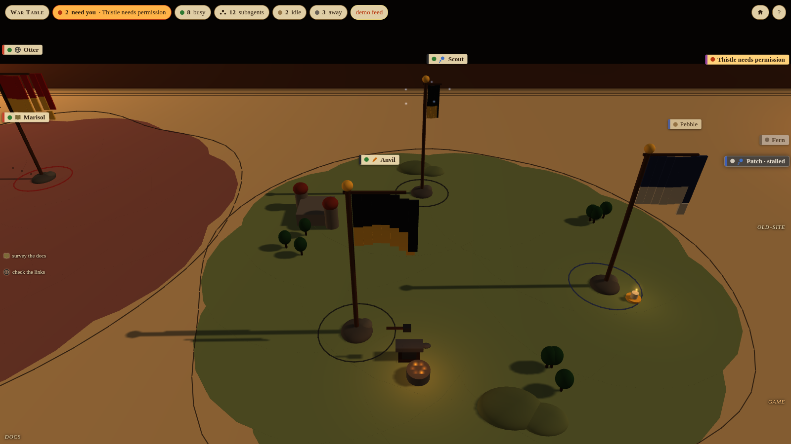
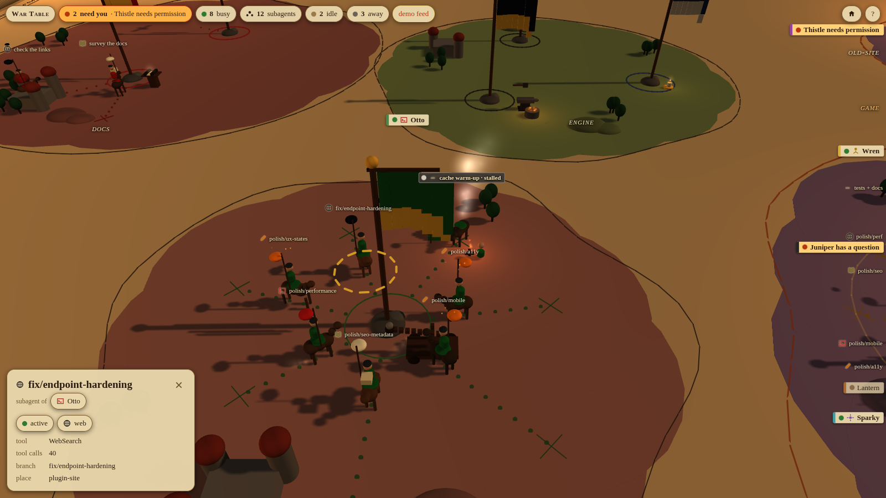

# agentviz-wartable

Your Claude Code sessions and their subagents drawn as a candle-lit medieval
campaign war table, rendered with
[Strata](https://github.com/Preponderous-Software/strata). Each repo is a
region on a parchment map. Each session is a banner planted in its region,
and its subagents are mounted scouts riding out from it. When a session needs
you, a beacon fire is lit on a hill beside its banner, with a "?" over it for
a question or a padlock for a permission prompt.

One of the [agentviz](https://github.com/dmccoystephenson/agentviz) family:
ten views of the same feed. Every image below comes from the bundled demo
feed (`--fixture`), never from live sessions.



*The whole table (demo feed). Seven regions (repos) hold fifteen banners
(sessions). Wren, Otto and Marisol have sent out scouts (subagents).
Thistle's and Juniper's beacons are lit because they are waiting on you;
Delta, Tally and Fern have lowered their banners (offline). Busier regions
have a stone keep with more towers.*


*Five seconds around Wren: the scouts ride their dotted paths while gold
ripples spread from the war horn (delegating). Early on one scout finishes
and rides out to make camp; later Wren makes a new tool call and a gold
burst flies from its finial. Juniper's beacon burns beside it.*

## Run

Needs Python 3.8 or newer and nothing else:

```bash
git clone https://github.com/dmccoystephenson/agentviz-wartable
cd agentviz-wartable
python3 -m vendor.agentfeed serve --web web --port 8850             # your live sessions
python3 -m vendor.agentfeed serve --web web --port 8850 --fixture   # the demo feed
```

Open <http://127.0.0.1:8850/> (the server binds 127.0.0.1 only and refuses
non-local `Host` headers). Live mode reads your Claude Code session files
under `~/.claude` and shows session names, states, git branches, tool names
and short labels (a file's basename, a Bash command's own description, a web
host, a subagent's description), never file contents, commands or prompts;
see the agentviz [SECURITY.md](https://github.com/dmccoystephenson/agentviz/blob/main/SECURITY.md).
Query options: `?fixture=1` (demo feed), `?fps=1` (frame stats),
`?quality=0|1|2`, `?drive=1` (hands scene time to tools).

Drag to orbit, right-drag or two fingers to pan, wheel or pinch to zoom. Tap
a banner or a scout for its card (a bottom sheet on a phone; swipe it down or
tap the cross to close). The **need you** chip names who is waiting and why
(a question, or a permission prompt), flies the camera to that beacon and
cycles through them; the house button recentres; **?** opens the legend. If
the feed stops answering, a banner says so and the last snapshot stays; with
no sessions at all, a hint says how to start.

## Close-ups



*Otto, a lead with seven scouts. Each rider wears Otto's banner colours
(cloak and saddle cloth), so you can tell whose scout it is. Each scout's
pennant is coloured by what that subagent is doing, and it rides a dotted
ink path to a cross on the map. Otto is running commands, so a catapult rolls
and throws beside his banner.*



*Thistle needs your permission: a beacon fire burns on a hill beside the
banner with a padlock floating over it, a ring pulses out across the map, the
region's border glows, and the label and HUD chip say why.*



*Juniper has a question: the same beacon, with a "?" over the fire.*


*In the Home Shire, Lantern is idle: the banner hangs still and a low candle
stub burns beside it. Tally is offline, so the banner is lowered to a stump
and greyed.*


*A resting scout (`tests + docs`, finished). It has made camp at the end of
its path: a tent in its lead's colours, a small campfire and the rider
sitting by it.*



*A stalled scout (`cache warm-up`): quiet for over five minutes without
finishing, so grey smoke rises over its camp and its label turns to a sooty
plate that says "stalled". A stalled banner's label does the same.*



*In the engine region, Anvil is editing (an anvil throwing sparks as the
hammer falls) and Scout is thinking (the banner is furled, with pale motes
drifting round it).*

## Two more angles


*Low and from the side, the way you would see it standing at the table.*


*From directly above, the table reads as a map: regions, banners, paths and
crosses.*

## Selecting


*Tap a banner or scout to select it. The card shows the session's state and
action, what it is doing, its branch and place, how many of its subagents
are active, and each scout as a chip you can tap to jump to it.*



*A scout working on its own git branch: its card shows that branch
(`fix/endpoint-hardening`, not its lead's `main`), its last tool and how
many tool calls it has made. On the map such a scout carries a small plate
with the branch under it, unless its lane label already names the branch,
as this one's does.*


*On a phone (390 x 844 at DPR 3) the regions are laid out deeper than wide,
so the map fills the screen held upright, and the top bar keeps to one line
(need you, busy, subagents). You orbit with one finger and pinch to zoom.
Tapping a banner opens a bottom sheet, shown here on Wren; the map slides up
so what you tapped stays in sight above the sheet.*

## Legend

| What you see | Meaning | Shown in |
|---|---|---|
| Region on the map (tint and outline from its seed) | a place (repo / working-directory basename) | hero |
| Stone keep with 1 to 4 towers on a region's rim | the place's tool calls (a tower per few doublings past 10) | hero |
| Banner (field colour + metal band from the session seed) | a session | hero |
| Banner waving | `busy` | hero |
| Beacon fire on a hill, pulsing ring, glowing border, HUD chip | `waiting`: **needs you** | closeup-waiting |
| A padlock / a "?" over the beacon | waiting on a permission prompt / on a question | closeup-waiting, closeup-question |
| Banner still, low candle stub | `idle` (and `dim`, greyer) | closeup-idle-offline |
| Banner lowered to a stump, greyed | `offline` | closeup-idle-offline |
| Grey smoke rising from a banner or a scout, a sooty "stalled" label | `stalled`: a session busy with nothing written for 5 min, or a subagent quiet that long without finishing | closeup-stalled-scout |
| Gold burst from the finial, gold ring at the foot (a scout's pennant flashes gold) | a new tool call | motion.gif |
| Smith's anvil, falling hammer, sparks | action `edit` | closeup-actions |
| Catapult rolling, winding and throwing a stone | action `run` | closeup-lead |
| Scroll unrolling on a lectern | action `read` | hero (Marisol) |
| Raven flying from the banner to the map edge and back, dotted flight line | action `web` | hero (Otter) |
| War horn on a stand, gold ripples spreading over the map | action `delegate` | motion.gif |
| Banner furled tight, pale motes | action `think` | closeup-actions |
| War drum being beaten | action `other` | hero (Sparky) |
| Mounted scout in the lead's colours, on a dotted path to an ink cross | a subagent (follower) of that lead | closeup-lead |
| Scout riding out and back | follower `active` | motion.gif |
| Tent, campfire, rider seated | follower `resting` | closeup-resting |
| Small brass-edged plate under a scout | the subagent's own git branch (when its label does not already say it) | |
| Scout pennant colour | follower action: orange edit, crimson run, cream read, black web, gold delegate, blue think, violet other | closeup-lead |
| Gold dashed ring | the selected banner or scout | panel-desktop |

Four candles at the table's corners are the room's light, and the beacon
fires take light priority over them, so they stay bright on weak devices.

## Build and test

```bash
python3 -m unittest discover -s tests       # serves the fixture; page, assets, feed, vendored PINs, no machine paths
npm ci && npx playwright install chromium   # Playwright 1.61.1, for the browser tests
pip install -r requirements-dev.txt         # Pillow, for the GIF
npm run smoke                               # headless Chromium on the demo feed; saves docs/media/screenshot.png
npm run screenshots                         # every image above (or some: npm run screenshots -- hero phone motion)
EMSDK=/path/to/emsdk vendor/agentviz-kit/scene/build-scene.sh scene/kit.conf   # rebuild web/wartable-engine.*
```

The built engine files are committed, so serving needs only Python. Tests
use port 9134 (`WARTABLE_TEST_PORT` overrides). `vendor/agentfeed/`,
`vendor/agentviz-kit/` and `web/agentviz-*` come from
[agentviz](https://github.com/dmccoystephenson/agentviz) (`tools/vendor-kit.sh`);
do not edit them here.

## How it works

The feed client, the HUD (chips, the selected-agent card and bottom sheet,
the banner), world labels, tap picking and the page-to-engine data format are
the shared agentviz kit (docs/KIT.md in agentviz). On top of it,
`web/wartable-model.js` keys everything by id, lays the regions out in a grid
wider than deep, plants banners round each region's centre, fans each
banner's scout points out from it, and eases everything between snapshots.
Each frame `web/wartable-frame.js` packs the scene in the agentviz wire
format; `scene/main.cpp` decodes it with `agentviz.h` and draws it with
Strata's primitives, lines, points and lights (`table.h`, `banner.h`,
`props.h`, `scout.h`).

## Licence

Code: [MIT](LICENSE). Screenshots and GIFs in `docs/media/`:
[CC0 1.0](LICENSE-media). The committed engine bundles Strata (MIT) and its
libraries, and the Emscripten runtime: see
[THIRD_PARTY_NOTICES.md](THIRD_PARTY_NOTICES.md).
